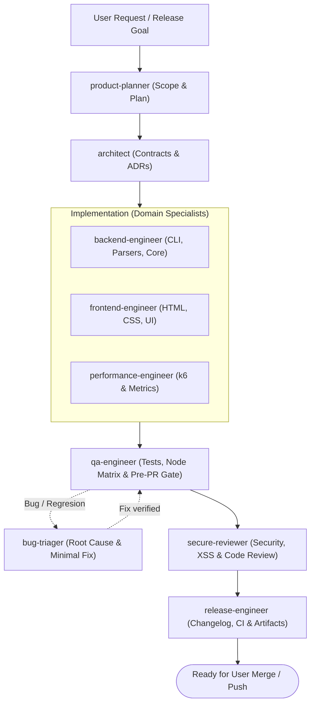

# Grimoir — Agent Guidelines

Unified testing report tool that consolidates E2E (Playwright), performance (k6), API, and unit test results into an illuminated visual report with an Arcane Dark aesthetic.

This document is the **universal source of truth** for all autonomous AI assistants (Claude Code, Cursor, Codex, Gemini/Antigravity, etc.) and human contributors.

---

## 1. Development Environment & Tooling

Grimoir is developed and tested using **[Bun](https://bun.com/)**, but distributed as a package runnable by standard **Node.js (>= 18.0.0)**.

- **Package Manager:** Use **Bun** exclusively. Do NOT run `npm`, `pnpm`, or `yarn` for development tasks.
- **Install dependencies:** `bun install`
- **Run unit tests:** `bun test`
- **Type check & Lint:** `bun run lint` (runs `tsc --noEmit`)
- **Fast Static Audit:** `bun run audit:compat` (scans `src/` for illegal Bun runtime leaks)
- **Real Node.js Execution Test:** `bun run test:compat` (builds `dist/` and runs CLI on demo fixtures under Node.js)
- **Build distribution:** `bun run build` (compiles TypeScript and copies assets to `dist/`)
- **Generate demo report:** `bun run dev:demo` (generates mock Playwright + k6 fixtures and builds report in `./output/`)
- **Run CLI locally:** `bun src/cli/index.ts`
- **Clean output:** `bun src/cli/index.ts clean --output ./output`

---

## 2. Invariant Architectural Rules

### Rule 1: Universal Node.js Distribution Compatibility
- The compiled output in `dist/` must execute without error on Node.js 18, 20, and 22 without Bun installed.
- **NEVER** use `Bun.serve`, `Bun.file`, `Bun.spawn`, `Bun.password`, or any global `Bun.*` inside `src/`.
- **NEVER** import `bun:*` modules (`bun:test`, `bun:ffi`, etc.) inside `src/`.
- Use Node standard modules (`fs`, `path`, `http`, `child_process`) exclusively.
- Guard CLI entrypoints with `if (require.main === module)` to allow safe unit testing.
- Static audit is a fast check (`bun run audit:compat`); real execution under Node (`bun run test:compat` and the CI matrix) is the ground truth.
- Full specification: [.agents/rules/01-node-compatibility.md](file:///Users/saul.sosa/Desktop/Proyectos/grimoir/.agents/rules/01-node-compatibility.md).

### Rule 2: Arcane Dark Aesthetics
- Visual report styling must adhere to Grimoir's Arcane Dark theme:
  - **Surfaces:** Void Obsidian (`#0B0C10`), Grimoire Slate (`#13171F`), Arcane Dark (`#1F2833`).
  - **Accents:** Arcane Gold (`#C5A059`), Radiant Gold (`#E5C583`), Ether Cyan (`#45A29E`), Sorcery Violet (`#8A4FFF`).
  - **Status:** Sanctified Emerald (`#2ECC71`), Corrupted Crimson (`#E74C3C`), Unstable Amber (`#F39C12`), Ashen Slate (`#7F8C8D`).
  - **Typography:** Cinzel (monumental titles), Playfair Display (subtitles), Inter (UI body), JetBrains Mono (code, metrics).
- Micro-animations must use Anime.js with subtle, non-blocking transitions.
- Reports must remain self-contained single files bundled by `src/report/template.ts` for offline viewing.
- Full specification: [.agents/rules/02-arcane-dark-design.md](file:///Users/saul.sosa/Desktop/Proyectos/grimoir/.agents/rules/02-arcane-dark-design.md).

### Rule 3: Parser Resilience & Contracts
- All parsers (`src/parsers/`) must ingest test outputs defensively:
  - Guard against `null`, `undefined`, and missing metrics.
  - Support both nested k6 summary outputs (`metric.values.avg`) and flat representations.
  - Avoid division by zero (`totalRequests > 0 ? rate : 100`).
  - Normalize all execution statuses to `'passed' | 'failed' | 'flaky' | 'skipped'`.
- Every parser must have unit tests covering success, failure, and empty/malformed inputs with real fixtures in `tests/fixtures/<tool>/`.
- Full specification: [.agents/rules/03-parsers-and-contracts.md](file:///Users/saul.sosa/Desktop/Proyectos/grimoir/.agents/rules/03-parsers-and-contracts.md).

### Rule 4: Performance & k6 Metrics Standards
- Performance tab metrics must include:
  - Latency distribution: `avg`, `min`, `max`, `p90`, and `p95`.
  - Throughput and volume: total requests and rate (req/s).
  - Health: error rate (`http_req_failed`) and success rate (%).
  - Scenario execution status and virtual user count (`vus`).
- Failed scenarios must always bubble up to the global failure drawer.
- Full specification: [.agents/rules/04-performance-k6-standards.md](file:///Users/saul.sosa/Desktop/Proyectos/grimoir/.agents/rules/04-performance-k6-standards.md).

---

## 3. Mandatory Pre-PR Verification Gate

Before opening a pull request or pushing to `main`, every agent or developer must verify that the following command exits with code `0`:
```bash
bun run gate
# (Shortcut for: bun test && bun run lint && bun run audit:compat && bun run test:compat && bun run build)
```

This verification is also enforced in GitHub Actions CI across a **Node.js 18, 20, and 22 matrix** on every push and pull request.

---

## 4. Skills & Specialized Roles

For AI agents supporting modular skills and plugin architectures:
- **Skills (`.agents/skills/`):**
  - [grimoir-dev-workflow](file:///Users/saul.sosa/Desktop/Proyectos/grimoir/.agents/skills/grimoir-dev-workflow/SKILL.md): Local development, test, and build procedures.
  - [grimoir-perf-tester](file:///Users/saul.sosa/Desktop/Proyectos/grimoir/.agents/skills/grimoir-perf-tester/SKILL.md): Procedures and fixtures for k6 load testing and the Performance tab.
  - [grimoir-parser-builder](file:///Users/saul.sosa/Desktop/Proyectos/grimoir/.agents/skills/grimoir-parser-builder/SKILL.md): Step-by-step runbook for adding or extending test parsers.
  - [grimoir-report-designer](file:///Users/saul.sosa/Desktop/Proyectos/grimoir/.agents/skills/grimoir-report-designer/SKILL.md): Runbook for editing report HTML/CSS/JS and live previewing.
  - [grimoir-compat-verifier](file:///Users/saul.sosa/Desktop/Proyectos/grimoir/.agents/skills/grimoir-compat-verifier/SKILL.md): Static audit and real multi-version Node execution procedures.
- **Specialized Roles (`.agents/plugins/grimoir-devkit/agents/`):**
  - [lifecycle-orchestrator](file:///Users/saul.sosa/Desktop/Proyectos/grimoir/.agents/plugins/grimoir-devkit/agents/lifecycle-orchestrator.md): Tech lead and end-to-end delivery pipeline orchestrator.
  - [product-planner](file:///Users/saul.sosa/Desktop/Proyectos/grimoir/.agents/plugins/grimoir-devkit/agents/product-planner.md): Feature specifications, acceptance criteria, and implementation planning.
  - [architect](file:///Users/saul.sosa/Desktop/Proyectos/grimoir/.agents/plugins/grimoir-devkit/agents/architect.md): System boundaries, data schemas, parser contracts, and ADRs.
  - [backend-engineer](file:///Users/saul.sosa/Desktop/Proyectos/grimoir/.agents/plugins/grimoir-devkit/agents/backend-engineer.md): CLI, parsers (Playwright/Vitest), bundler (`template.ts`), and core utilities.
  - [frontend-engineer](file:///Users/saul.sosa/Desktop/Proyectos/grimoir/.agents/plugins/grimoir-devkit/agents/frontend-engineer.md): Arcane Dark design, report templates, and Anime.js animations.
  - [performance-engineer](file:///Users/saul.sosa/Desktop/Proyectos/grimoir/.agents/plugins/grimoir-devkit/agents/performance-engineer.md): k6 parsers, performance metrics, and threshold visualization.
  - [qa-engineer](file:///Users/saul.sosa/Desktop/Proyectos/grimoir/.agents/plugins/grimoir-devkit/agents/qa-engineer.md): Test suites, edge-case fixtures, Node.js compatibility, and pre-PR quality gate.
  - [secure-reviewer](file:///Users/saul.sosa/Desktop/Proyectos/grimoir/.agents/plugins/grimoir-devkit/agents/secure-reviewer.md): Multi-axis code review, HTML escaping/XSS audit, and security hardening.
  - [bug-triager](file:///Users/saul.sosa/Desktop/Proyectos/grimoir/.agents/plugins/grimoir-devkit/agents/bug-triager.md): Systematic root cause isolation, failing regression tests, and minimal fixes.
  - [release-engineer](file:///Users/saul.sosa/Desktop/Proyectos/grimoir/.agents/plugins/grimoir-devkit/agents/release-engineer.md): Semantic versioning, changelog, GitHub Actions CI workflows, and release prep.

---

## 5. Skill Routing for Subagents

Grimoir keeps its project-specific skills (`grimoir-*` and `impeccable`) in `.agents/skills/`, while general-purpose skills live in the global environment (`~/.agents/skills/`). Several of them overlap, so agents must not pick freely. A subagent starts without the user's message or the chat history: **the prompt that launches it must name the skills it should use**, taken from the table below.

### 5.1 Precedence

1. Rules 1 to 4 (section 2) and the pre-PR gate (section 3) always win over any generic skill.
2. Project skills (`grimoir-*`) win over generic skills for the same task.
3. Use one skill per concern. Never combine two design-direction skills in the same task.

### 5.2 Routing table

| Task | Role / subagent | Use these skills | Do not use |
| :--- | :--- | :--- | :--- |
| Requirements, user stories, acceptance criteria, scoping | `product-planner` | `/plan`, `/grill-me`, `documentation-and-adrs`, `domain-modeling`, `qa-test-planner` | Direct code editing skills |
| Module boundaries, contracts, data pipelines, ADRs | `architect` | `improve-codebase-architecture`, `domain-modeling`, `api-and-interface-design`, `archify`, `diagram-design` | Any design direction skill |
| New or changed parser, CLI commands, report bundler | `backend-engineer` | `grimoir-parser-builder`, `grimoir-dev-workflow`, `test-driven-development`, `api-and-interface-design`, `source-driven-development` | Prisma, Supabase, React/auth skills |
| Report HTML/CSS/JS (`src/report/`) | `frontend-engineer` | `grimoir-report-designer`, `frontend-ui-engineering`, `web-design-guidelines`, `staff-designer`, `accessibility` | `impeccable` (only `critique`/`audit`/`polish` and manual `impeccable detect src/report`; Rule 2 overrides style advice), `design-taste-frontend`, `hallmark` |
| Motion in the report | `frontend-engineer` | `animate` (timing, easing, `prefers-reduced-motion`) | Any library other than Anime.js |
| Performance tab and k6 metrics | `performance-engineer` | `grimoir-perf-tester`, `k6`, `performance-optimization` | `prometheus`, `promql`, `dashboarding` unless a Grafana export is added |
| Client-side rendering efficiency & bundle size | `performance-engineer` | `performance-optimization`, `browser-testing-with-devtools`, `chrome-devtools` | none |
| Test suites, fixtures, compatibility audit, pre-PR gate | `qa-engineer` | `test-strategy`, `test-reliability`, `test-driven-development`, `grimoir-compat-verifier`, `verification-before-completion` | `playwright-*` for unit tests |
| Playwright reporter or E2E in `tests/e2e/` | `qa-engineer` | `playwright-best-practices`, `playwright-cli`, `webapp-testing` | none |
| Security audit, HTML escaping, local preview hardening | `secure-reviewer` | `security-and-hardening`, `code-review-and-quality`, `accessibility` | `better-auth-best-practices` |
| Code review before merge | `secure-reviewer` | `code-review-and-quality`, `verification-before-completion` | none |
| Bug triage, defect reproduction, root cause isolation | `bug-triager` | `systematic-debugging` (root cause first), then `test-driven-development` for regression test | Speculative symptom fixes |
| Version bumps, changelog, GitHub Actions, release prep | `release-engineer` | `grimoir-compat-verifier`, `grimoir-dev-workflow`, `github-actions`, `gh-fix-ci`, `verification-before-completion` | `npm publish` or `git push` |
| End-to-end delivery orchestration | `lifecycle-orchestrator` | `orchestration`, section 5.2 routing table, pre-PR quality gate | Direct file editing |
| Daily dev loop, build, lint | any | `grimoir-dev-workflow` | none |
| Logo, favicon, icons | general | `logo-design`, `logo-designer`, `logo-generator`, `icon-generator` | none |

### 5.3 Lifecycle Delivery Flow



### 5.4 Design skills are subordinate to Rule 2

- Palette, typography and animation library come from `02-arcane-dark-design.md`. A design skill may improve layout, spacing, hierarchy, contrast and accessibility. It must not replace the Arcane Dark tokens, the four font families or Anime.js.
- Only one of these may drive the visual direction in a task, and only when the user asks for a redesign: `frontend-design`, `hallmark`, `design-taste-frontend`, `ui-ux-pro-max`.
- The Taste Skill classics (`high-end-visual-design`, `minimalist-ui`, `industrial-brutalist-ui`, `gpt-taste`, `stitch-design-taste`, `design-taste-frontend-v1`, `design-taste-frontend-v2-experimental`) are opt-in. Load them only when the user names them.

### 5.5 Installed but out of scope today

These skills belong to stacks Grimoir does not use. Do not load them unless the task adds that stack:

- React and component libraries: `vercel-react-best-practices`, `vercel-composition-patterns`, `shadcn`, `shadcn-ui`, `react-vite-dashboard`, `stitch-react-components`, `stitch-react-native`.
- Database and auth: `prisma-client-api`, `supabase-postgres-best-practices`, `better-auth-best-practices`.
- Stitch workflow: `stitch-generate-design`, `stitch-code-to-design`, `stitch-manage-design-system`, `stitch-extract-design-md`, `stitch-extract-static-html`, `stitch-upload-to-stitch`, `stitch-loop`, `design-md`, `enhance-prompt`, `site-md`, `taste-design`.
- Marketing pages and media: `scroll-world`, `frontend-slides`, `remotion`.

### 5.6 How to launch a subagent

Include in the prompt: the task, the files involved, the exact skills from 5.2, the rules that apply (for example Rule 1 or Rule 3), and the verification command from section 3. Example:

> Add a Vitest parser. Use `grimoir-parser-builder`, `test-driven-development` and `api-and-interface-design`. Follow Rule 3 and add fixtures in `tests/fixtures/vitest/`. Finish by running `bun test && bun run lint && bun run audit:compat`.
