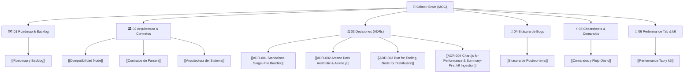

---
tags:
  - grimoir/hub
  - map-of-content
  - second-brain
updated: 2026-11-12
status: active
---

# 🧠 Grimoir Second Brain — Map of Content (MOC)

> *"Un grimorio vivo de conocimiento: donde el código, las decisiones arquitectónicas y la memoria de los agentes convergen en la oscuridad iluminada."*

Bienvenido al centro neurálgico de **Grimoir**. Este vault de Obsidian funciona como el **Segundo Cerebro** compartido entre el desarrollador y los agentes autónomos de Antigravity.

---

## 🧭 Mapa de Navegación Rápida

---

## 🗂️ Secciones del Cerebro

### 1. [[Roadmap y Backlog|🗺️ 01. Roadmap & Backlog]]
- Estado de los parsers (Playwright, k6, Vitest, Newman, Cypress).
- Épicas de producto y mejoras de la interfaz visual.

### 2. Arquitectura y Contratos
- [[Arquitectura del Sistema|🏛️ Arquitectura General]]: Flujo de datos desde la ingesta de JSON hasta el HTML único.
- [[Contratos de Parsers|📜 Contratos de Parsers]]: Tipos normalizados (`passed`, `failed`, `flaky`, `skipped`) y métricas de k6.
- [[Compatibilidad Node|🛡️ Compatibilidad Node.js]]: La regla de oro: Bun para desarrollo, Node 18+ para distribución.

### 3. Registro de Decisiones de Arquitectura (ADRs)
- [[ADR-001 Standalone Single-File Bundler|ADR-001]]: Por qué bundled en un solo archivo HTML sin servidor.
- [[ADR-002 Arcane Dark Aesthetic & Anime.js|ADR-002]]: La estética oscura arcana y micro-animaciones con Anime.js.
- [[ADR-003 Bun for Tooling, Node for Distribution|ADR-003]]: Bun internamente, Node para distribución universal.
- [[ADR-004 Chart.js for Performance & Summary-First k6 Ingestion|ADR-004]]: Chart.js para la pestaña Performance e ingesta summary-first de k6.

### 4. [[Bitacora de Postmortems|🐞 04. Bitácora de Bugs y Aprendizajes]]
- Errores complejos resueltos, causas raíces y cómo evitar que se repitan.

### 5. [[Comandos y Flujo Diario|⚡ 05. Cheatsheets & Guías Rápidas]]
- Comandos diarios de desarrollo, tests, lint y el gate pre-PR (`bun run gate`).

### 6. [[Performance Tab y k6|🔮 06. Pestaña Performance & k6]]
- Documentación viva de la pestaña `#tab-perf`: parser de k6, métricas personalizadas, gráficas Chart.js, Failure Drawer y comandos de prueba.

---

## 📜 Documentos Fundacionales del Repositorio
- [[PRODUCT|📄 Visión de Producto (`PRODUCT.md`)]]: Propósito, usuarios objetivo y principios de Grimoir.
- [[DESIGN|🎨 Sistema de Diseño (`DESIGN.md`)]]: Tokens de color Arcane Dark, tipografías y reglas de contraste.
- [[AGENTS|🤖 Reglas de Agentes (`AGENTS.md`)]]: Instrucciones operativas y roles para asistentes de IA.

---

> [!NOTE] ¿Cómo interactúa Antigravity con este Vault?
> * **Al iniciar tareas:** El agente consulta este archivo y sus notas vinculadas para no perder contexto.
> * **Al resolver bugs:** El agente documenta la lección aprendida en [[Bitacora de Postmortems]].
> * **Al añadir features:** El agente actualiza el estado en [[Roadmap y Backlog]].
