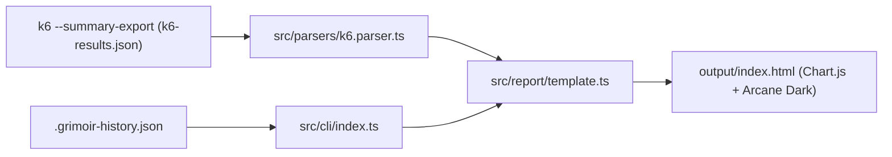

---
tags:
  - grimoir/performance
  - grimoir/k6
  - grimoir/frontend
  - grimoir/chartjs
updated: 2026-11-12
status: active
branch: feat/k6-performance-tab
---

# 🔮 Pestaña Performance y k6 (`#tab-perf`)

Nota viva del Segundo Cerebro que documenta todo lo implementado para la pestaña **Performance** de **Grimoir** en la rama `feat/k6-performance-tab`.

> [!NOTE] Contexto de Sesión
> Esta nota consolida el diseño, contratos, decisiones técnicas, comandos de prueba y estado actual para retomar el trabajo sin perder contexto tras compactar el historial.

---

## 1. Flujo de Datos End-to-End

---

## 2. Qué se implementó por capa

### A. Parser de k6 (`src/parsers/k6.parser.ts`)
- **Mediana (`medLatencyMs`)**: extraída de `http_req_duration.values.med` / `p(50)`.
- **Thresholds enriquecidos (`K6ThresholdStatus`)**: incluye `actualValue` observado (con unidad `ms`, `%`, `req/s`) y `reason` legible explicando **por qué** pasó o falló.
- **Checks recursivos (`K6CheckItem[]`)**: recorre `root_group.checks` y sub-grupos anidados (`groups`), calculando `passes`, `fails`, `passRate`, `status` y `reason`.
- **Fases HTTP (`K6HttpPhaseMetric[]`)**: extrae en orden estándar `http_req_blocked`, `http_req_connecting`, `http_req_tls_handshaking`, `http_req_sending`, `http_req_waiting` (TTFB) y `http_req_receiving` (`avgMs`, `p95Ms`, `maxMs`).
- **Métricas personalizadas (`K6CustomMetric[]`)**: filtra `STANDARD_K6_METRICS` (y sub-métricas con tags `{...}`) para capturar `trend`, `counter`, `rate` y `gauge`.
- **Scenarios (`K6Scenario`)**: agrega `reason` descriptivo por escenario.

### B. CLI e Histórico (`src/cli/index.ts` & `package.json`)
- **`HistoricalRun.k6`**: guarda `p95LatencyMs`, `avgLatencyMs`, `errorRatePercent` y `throughputRps` en `.grimoir-history.json` (máximo 20 runs).
- **Comando `grimoir open`**: abre `./output/index.html` (o `-f <path>`) en el navegador predeterminado usando `child_process.spawn` (compatible con macOS, Linux y Windows bajo Node.js).
- **Scripts en `package.json`**:
  - `bun run open` → abre el reporte actual.
  - `bun run dev:open` → regenera fixtures demo, compila `output/index.html` y lo abre.

### C. Bundler y Reglas de Salud (`src/report/template.ts`)
- **Failure Drawer Global (`buildFailures`)**: propaga *thresholds* incumplidos, *checks* con `fails > 0` y *scenarios* fallidos con su `reason` y snippet de valor observado.
- **Health Score (`UNVERIFIED` vs `HEALTHY`)**: si hay métricas de k6 activas pero `thresholds.total === 0` (`NO THRESHOLDS`), el Health Score marca **`UNVERIFIED`** (ámbar `#fbbf24`) en lugar de `HEALTHY` (verde).
- **Tablas generadas con `escapeHtml` y `grimoir-table-wrapper`**:
  - `Threshold Rule Details` (con valor observado y motivo).
  - `k6 Check Assertions` (ruta de grupo, `passes/fails`, barra `%` y motivo).
  - `Custom k6 Metrics` (badges `TREND`, `RATE`, `COUNTER`, `GAUGE`).
  - `Scenario Runs` (con detalle/motivo de ejecución).

### D. UI, Chart.js y Modern Web Guidance (`template.html`, `script.js`, `styles.css`)
- **`#perfChart` (Response Time Percentiles)**: 6 barras (`Avg`, `Min`, `Med`, `Max`, `P90`, `P95`) + selector `#perfTrendSelector` agrupado (`<optgroup>` *Standard HTTP* / *Custom Trends*) + filtro en vivo `#perfTrendSearch`.
- **`#perfPhasesChart` (HTTP Timing Breakdown)**: barras horizontales `Avg` vs `P95` + toggle **`Linear | Log`** (`#perfPhasesScaleLinear` / `#perfPhasesScaleLog`).
- **`#perfHistoryChart` (Performance Historical Trend)**: líneas de doble eje (`P95 Latency` y `Throughput`) sobre los últimos 20 runs.
- **Modern Web Guidance**: `color-scheme: dark`, `accent-color: #8A4FFF`, `scrollbar-color` accesible y `thead` `sticky` (`position: sticky; inset-block-start: 0`) en `.grimoir-data-table`.

---

## 3. Verificación y Documentación
- **Tests (`bun test`)**: **53 pasados, 0 fallidos** (297 aserciones), incluyendo pruebas XSS y placeholders en `tests/unit/template.test.ts` y `tests/unit/k6.parser.test.ts`.
- **Gate completo (`bun run gate`)**: en verde (TypeScript, auditoría Node.js, ejecución real en Node.js y build).
- **`README.md`**: documentada la persistencia de `.grimoir-history.json` en CI/CD (`actions/cache@v4`) y el comando `grimoir open`.
- **`DESIGN.md` y `.impeccable/design.json`**: sincronizados (Merge) con los tokens de Performance.

---

## 🔗 Enlaces Relacionados
- [[Grimoir Brain]]
- [[ADR-004 Chart.js for Performance & Summary-First k6 Ingestion]]
- [[Contratos de Parsers]]
- [[Roadmap y Backlog]]
